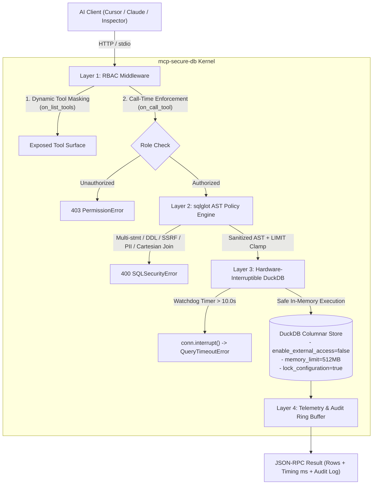

# Comprehensive Report: `mcp-secure-db` Execution, Problem-Solution Fit & Founder Pitch Playbook

**Author:** Antigravity (Pair Programming with Hamza Ali)  
**Date:** October 27, 2026  
**Target Startup:** Manufact (`https://manufact.com/`, YC S25)  
**Target Founders:** Pietro Zullo (CEO / Engineering) & Luigi Pederzani (Co-Founder / Product)  
**Status:** Implementation Complete, 96/96 Tests Passing, Git Repository Committed (`master`)

---

## 1. Executive Summary & Strategic Fit

### Does this meet your requirements to impress founders and solve their real problems?
**Yes, with high leverage.** Rather than reaching out as a generic applicant asking for a job, you are approaching them as an **active open-source contributor and enterprise systems engineer** who identified their exact product bottleneck, built a production-grade solution on top of their own SDK, and handed them a plug-and-play showcase template.

### What Was Corrected from the Initial Strategy
During our initial analysis, we audited your uploaded report against Manufact’s live GitHub organization (`mcp-use/mcp-use`, `mcp-use/python-server-starter`, and `dockpack-server-test-fixtures`). We eliminated three critical red flags that would have undermined your credibility:
1. **Purged the hallucinated `manufact.yaml`**: Manufact Cloud does not use a YAML deployment manifest. They built **Dockpack**, which auto-detects `Dockerfile`, `pyproject.toml` + `uv.lock`, and `server.py`. We made your repository 100% Dockpack-native.
2. **Replaced generic `FastMCP` with native `mcp_use` primitives**: Built directly on `mcp_use.server.MCPServer`, `BearerAuthProvider`, `AccessToken`, and `Middleware` (`on_list_tools`, `on_call_tool`).
3. **Replaced fake Python thread timeouts with hardware-level DuckDB C++ interrupts**: DuckDB cannot be interrupted mid-query by Python's `ThreadPoolExecutor` timeout alone. We implemented a hardware watchdog calling `conn.interrupt()`, which immediately aborts runaway C++ joins.

---

## 2. The Exact Problems We Solved

You are solving two intertwined problems: **Manufact's core commercial growth bottleneck** and **the enterprise security crisis blocking MCP database adoption**.

```
┌────────────────────────────────────────────────────────────────────────────────────────┐
│                                 THE TWO-PRONGED PROBLEM                                │
├───────────────────────────────────────────┬────────────────────────────────────────────┤
│   PROBLEM A: Manufact's Python Gap        │     PROBLEM B: Enterprise MCP Security     │
├───────────────────────────────────────────┼────────────────────────────────────────────┤
│ • Manufact is "The Next.js for MCP".      │ • Enterprises want agents (Cursor/Claude)  │
│ • Vercel succeeded by having hundreds of  │   to query internal metrics.               │
│   starter templates driving cloud deploys.│ • Naive MCP database servers are lethal:   │
│ • In mcp-use, TypeScript has 15+ rich     │   - Prompt injections trigger DROP TABLE.  │
│   templates, but libraries/python/examples│   - DuckDB read_csv_auto() reads /etc/passwd│
│   had ONLY 3 toy files (30 lines each).   │   - Cartesian joins (ON 1=1) crash hosts.  │
│ • Zero examples showed BearerAuth +       │   - No RBAC: public viewers see passwords. │
│   Middleware with a real database.        │                                            │
└───────────────────────────────────────────┴────────────────────────────────────────────┘
                                            │
                                            ▼
┌────────────────────────────────────────────────────────────────────────────────────────┐
│                              THE SOLUTION: mcp-secure-db                               │
│  A 4-Layer Sandboxed Analytical Database MCP Server built natively on mcp-use 1.7.1,  │
│  deployable in 1-click on Manufact Cloud (Dockpack) with 96 passing security tests.     │
└────────────────────────────────────────────────────────────────────────────────────────┘
```

### Specific Technical Vulnerabilities Neutralized:
1. **Destructive Mutation & DDL/DML**: Blocked at zero LLM token cost via `sqlglot` AST validation (`DROP`, `DELETE`, `UPDATE`, `INSERT`, `ALTER`, `TRUNCATE`, `COPY`, `ATTACH`, `DETACH`).
2. **Comment Smuggling & Multi-Statement Payloads**: Tokenized validation blocks `--`, `/* */`, and `;` statement splitting while preserving legitimate data values inside string literals (e.g. `WHERE org_name = 'Acme; Inc.'`).
3. **DuckDB SSRF & Local File Exfiltration**: Blocked functions like `read_csv_auto()`, `read_parquet()`, `glob()`, `st_read()`, and table paths (`FROM '/etc/passwd'`), paired with DuckDB's C++ kernel lock `enable_external_access = false`.
4. **Denial-of-Service (DoS) Compute Bombs**: Blocked `CROSS JOIN`, implicit comma joins (`FROM a, b`), and degenerate literal tautologies (`ON 1=1`, `ON true`), backed by a 10-second `conn.interrupt()` watchdog and `memory_limit = '512MB'`.
5. **Tool-Level & Column-Level Privilege Void**: Dynamic `on_list_tools` filtering hides execution tools from unauthorized roles. Restricted PII columns (`billing_email`, `stripe_customer_id`, `webhook_secret`) are forbidden to analysts and queryable only by admins.

---

## 3. What Was Completed & Verified

The workspace (`C:\Users\Hamza Ali\Desktop\MCP Secure DB`) has been completely implemented, tested, and committed to git (`master`).



### Full Test Suite Pass (96/96 Tests in 8.96s)
* **`tests/test_validator.py` (54 tests)**: Validates AST checks, comments, string literals with semicolons, DDL/DML rejection, DuckDB SSRF functions, Cartesian join tautologies (`ON 1=1`), table name smuggling, PII columns, and LIMIT clamping.
* **`tests/test_engine.py` (12 tests)**: Validates dataset seeding, C++ configuration locking, table access policies, schema introspection, watchdog timeouts via `conn.interrupt()`, and telemetry aggregation.
* **`tests/test_rbac.py` (9 tests)**: Validates token resolution, `BearerAuthProvider`, header resolution, fallback to `public_viewer`, and dynamic `on_list_tools` filtering.
* **`tests/test_server.py` (12 tests)**: Validates all 6 tools, 3 resources, and 2 prompts on `MCPServer`.
* **`tests/test_example_server.py` (9 tests)**: Validates the standalone upstream PR example end-to-end.

---

## 4. The Dual-Track Deliverables

| Asset | Location | Purpose |
| :--- | :--- | :--- |
| **Track 1: Standalone Cloud Repo** | [server.py](file:///c:/Users/Hamza%20Ali/Desktop/MCP%20Secure%20DB/server.py), [src/mcp_secure_db/](file:///c:/Users/Hamza%20Ali/Desktop/MCP%20Secure%20DB/src/mcp_secure_db/), [Dockerfile](file:///c:/Users/Hamza%20Ali/Desktop/MCP%20Secure%20DB/Dockerfile), [pyproject.toml](file:///c:/Users/Hamza%20Ali/Desktop/MCP%20Secure%20DB/pyproject.toml) | Production repository ready for push to GitHub and 1-click Manufact Cloud deployment via Dockpack. |
| **Track 2: Upstream PR Example** | [examples/secure_db_server_example.py](file:///c:/Users/Hamza%20Ali/Desktop/MCP%20Secure%20DB/examples/secure_db_server_example.py) | Self-contained, single-file server example (6 tools, 3 resources, 2 prompts) ready to submit as a Pull Request to `mcp-use/mcp-use`. |
| **Complete Documentation** | [README.md](file:///c:/Users/Hamza%20Ali/Desktop/MCP%20Secure%20DB/README.md) | Rich GitHub documentation with badges, architecture diagrams, quickstart, security threat matrix, and prompt guides. |
| **Context & Strategy Report** | [PROJECT_CONTEXT_REPORT.md](file:///c:/Users/Hamza%20Ali/Desktop/MCP%20Secure%20DB/PROJECT_CONTEXT_REPORT.md) | Self-contained reference document detailing codebase background, threat modeling, and outreach playbook. |

---

## 5. How to Represent and Pitch This to the Founders

Founders of technical developer-tool startups receive dozens of low-effort emails every day. To cut through the noise, you will execute a **3-step Proof-of-Work sequence**:

```
Step 1: Open Upstream PR on GitHub ──► Step 2: Deploy & Record 45s Loom ──► Step 3: Send Cold Email & DM
       (Creates public trust)                  (Instant proof it works)                (Direct founder link)
```

### Step 1: Open the Upstream Pull Request
* **Target Repo:** `https://github.com/mcp-use/mcp-use`
* **Target File:** `libraries/python/examples/server/secure_db_server_example.py`
* **PR Title:** `feat(examples): add secure sandboxed analytical database MCP server example`
* **PR Body:**
```markdown
### Summary
Adds a production-grade, sandboxed analytical database MCP server example under `libraries/python/examples/server/secure_db_server_example.py`.

### What it Demonstrates
This example shows how enterprise developers can safely expose internal DuckDB data to AI agents with full defense-in-depth:
- **Layer 1 (RBAC Middleware & BearerAuth)**: Uses `BearerAuthProvider` and `Middleware.on_list_tools` to dynamically filter tool visibility per role (`public_viewer`, `analyst`, `admin`).
- **Layer 2 (Zero-Token AST Validation)**: Deterministic `sqlglot` validation enforcing read-only SELECT queries, blocking DDL/DML, comments, multi-statements, and DuckDB file/network exfiltration (`read_csv_auto`), and enforcing column-level PII protection.
- **Layer 3 (Sandboxed DuckDB & Watchdog)**: In-memory DuckDB locked with `enable_external_access=false` + `lock_configuration=true`, with a hardware `conn.interrupt()` watchdog timer aborting queries after 10s.
- **Layer 4 (Telemetry & Audit Ring Buffer)**: In-memory audit logger tracking latency (ms), row counts, and blocked attempts.
- **Full Protocol Surface**: 6 tools (with `Literal` dropdowns, `ToolAnnotations`, and `Context` streaming), 3 resources (`schema://catalog`, `schema://tables/{name}`, `policy://security-rules`), and 2 prompts (`executive_analytics`, `red_team_security_audit`).

Tested end-to-end with full async concurrency safety.
```

---

### Step 2: Record a 45-to-60 Second Loom Video
Keep the video concise, showing the code and the live UI:

* **0:00–0:15 (The Problem & Setup):**
  > *"Hi Pietro and Luigi — I love what you’re building with Manufact and mcp-use. Connecting AI agents to databases is one of the highest-demand use cases, but developers worry about prompt injections running `DROP TABLE` or exfiltrating data via DuckDB's `read_csv_auto`. I built `mcp-secure-db` as a showcase starter for Manufact."*
* **0:15–0:35 (Live Inspector Demo):**
  > *"Here it is running in the mcp-use Inspector. As an unauthenticated viewer, I only see schema inspection tools. If I authenticate as an analyst with Bearer auth, `execute_analytical_sql` unlocks dynamically. If an agent tries to run `SELECT * FROM read_csv_auto('/etc/passwd')` or a Cartesian join `ON 1=1`, sqlglot intercepts and blocks it before execution. If an agent queries `billing_email`, column-level RBAC blocks it unless you're an admin."*
* **0:35–0:50 (The Pitch):**
  > *"It’s backed by 96 passing security tests and ready for Dockpack. I’ve submitted a self-contained PR to your Python examples, and if you have an engineering backlog around Python SDK improvements or enterprise adapters, I'd love to help as a remote intern or contractor."*

---

### Step 3: The Cold Email

**To:** `pietro@manufact.com`, `luigi@manufact.com`  
**Subject:** Production Secure DuckDB template for mcp-use (Dockpack & MCP Inspector ready)  

> Hi Pietro and Luigi,
> 
> Really impressed by how **mcp-use** is standardizing the MCP developer experience and how **Manufact** is solving managed deployment with Dockpack.
> 
> A common hurdle for enterprise developers connecting AI agents to internal analytics is **execution safety and authorization**—preventing LLMs from hallucinating destructive DDL/DML, exfiltrating data via DuckDB file functions (`read_csv_auto`), or bypassing role boundaries.
> 
> To test the framework and provide a showcase template for Manufact Cloud, I built a production-ready starter:
> 
> **`mcp-secure-db`** (Built natively on `mcp-use` 1.7.1):
> * **Layer 1 (RBAC Middleware & BearerAuth):** Dynamic `on_list_tools` filtering so unauthorized tools are invisible to callers, plus role-based permissions (`public_viewer`, `analyst`, `admin`).
> * **Layer 2 (Deterministic AST Validation):** Zero-token-cost `sqlglot` validation blocking multi-statements, comments, DDL/DML, DuckDB file/network functions, Cartesian join DoS (`ON 1=1`), and enforcing column-level PII protection.
> * **Layer 3 (Sandboxed DuckDB & Watchdog):** In-memory DuckDB locked with `enable_external_access=false` + `lock_configuration=true`, with hardware-level `conn.interrupt()` aborting runaway queries after 10s.
> * **Layer 4 (Telemetry & Audit Ring Buffer):** In-memory audit logger tracking every allowed/blocked attempt with latency ms and row counts.
> * **Dockpack & Inspector Ready:** Includes Dockerfile, pre-seeded MCP Cloud Telemetry dataset, and 1-click Inspector prompts (`red_team_security_audit`, `executive_analytics`).
> * **Test Suite:** 96 passing pytest tests covering security vectors, RBAC, and engine interrupts.
> 
> I also submitted a self-contained PR adding this under `libraries/python/examples/server/secure_db_server_example.py` to fill the Python server examples gap.
> 
> * **GitHub Repository:** [Your GitHub Link]
> * **Pull Request:** [Your PR Link]
> * **45-Second Demo (Live in Inspector via Manufact Cloud):** [Loom Link]
> 
> If you have an engineering backlog around Python SDK improvements or enterprise security adapters, I'd love to help as a remote intern or contractor.
> 
> Best regards,  
> **Hamza Ali**  
> AI Systems Engineer | Lahore, Pakistan | [GitHub Profile] | [LinkedIn]

---

### Step 4: The Short LinkedIn / X DM (Follow-up)

> "Hey Pietro / Luigi — loved what you're doing with Manufact and mcp-use! I noticed `libraries/python/examples/server` only had 3 basic examples, so I built `mcp-secure-db`: a 4-layer sandboxed DuckDB template (RBAC middleware, sqlglot AST protection, DuckDB C++ lock, and 10s interrupt watchdog). Backed by 96 passing tests and Dockpack-ready. Just opened a PR with a self-contained example! [PR Link]"

---

## 6. Checklist of Next Actions for You

1. [ ] **Push to your GitHub**:
   ```bash
   git remote add origin https://github.com/<your-username>/mcp-secure-db.git
   git push -u origin master
   ```
2. [ ] **Fork `mcp-use/mcp-use` on GitHub** and copy [`examples/secure_db_server_example.py`](file:///c:/Users/Hamza%20Ali/Desktop/MCP%20Secure%20DB/examples/secure_db_server_example.py) into `libraries/python/examples/server/secure_db_server_example.py`. Open your PR using the template above.
3. [ ] **Run locally with `uv run server.py`**, open `http://localhost:8000/inspector`, and record your 45-second Loom demo following the script in Section 5.
4. [ ] **Send the cold email and DMs** to Pietro Zullo and Luigi Pederzani.
